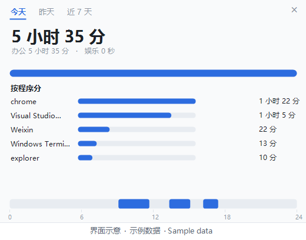
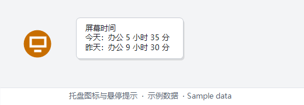
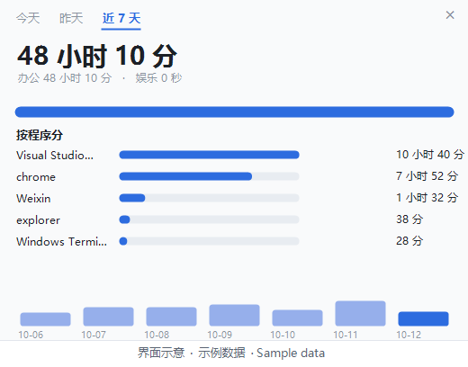

# 屏幕点亮时长

**简体中文** ｜ [English](README.md)

Windows 不会告诉你今天屏幕亮了多久：任务管理器里没有这个数，系统设置里也没有。
想知道自己一天在电脑前待了几个小时、中间断过几次，只能自己掐表。
这个小工具把这件事变成托盘上的一个数字。



**界面示意：图里是示例数据，不是任何人的使用记录。**

**给谁用**：想知道自己一天在电脑前待了几个小时、又不想装一套监控软件的人。

**为什么值得挂在托盘上**

- **纯本地，不联网**：所有记录都只在这台机器上。
- **不是猜的**：时间来自系统的显示器电源通知，屏幕亮起开始算、灭掉结束。
- **不留尾巴**：不要管理员、不装运行库、没有系统服务，删掉一个文件夹就干净了。
- **一眼看得懂**：托盘上是今天的办公时长，打开明细能看到按程序分和 24 小时时间轴。

版本 1.1 ｜ MIT 许可（见 [LICENSE](LICENSE)）｜ 个人自用工具，Windows 10/11，不保证适配你的环境

---

## 什么算「在用」

一句话：**屏幕亮着就算，屏幕灭了就停。**

不判断你在不在电脑前，也不看键盘鼠标有没有动。屏幕亮着的那段时间全部计入，
哪怕你手停了、在看视频、在发呆。

一段的起点是屏幕亮起（或者程序启动），终点是屏幕灭掉（或者程序退出、机器睡眠）。

## 它长什么样

- **图标**：橙色圆圈，里面是今天的办公时长，格式是「小时:分钟」。
  
- **鼠标悬停**：显示今天的办公时长、娱乐时长、昨天的办公时长。
  

- **右键菜单**：

| 菜单项 | 作用 |
| --- | --- |
| 明细 | 从右下角弹出一张面板，点别的地方自动收起 |
| 立即刷新 | 马上更新一次数字（不弹窗） |
| 打开所在文件夹 | 打开本工具所在的文件夹 |
| 退出 | 结束程序 |

托盘图标左键单击是开关：点一下打开明细，再点一下收起来；也可以点面板外面，或者点右上角的叉。右键菜单里是同一套功能。

### 明细面板

打开就是一张图，不用读文字：

- 左上角三个标签切换**今天 / 昨天 / 近 7 天**，默认是今天。
- 中间一行大字是总时长，下面小字写办公和娱乐各多少。
- 再下面一条色条，办公是蓝色、娱乐是橙色，按比例分。
- 然后是**按程序分**：每个程序一行，条长按比例，右边是时长，娱乐的用橙色并标注。
- 最下面是当天的一条 **24 小时时间轴**，蓝色的块就是屏幕亮着的时段，一眼看出什么时候在用、中间断了多久。
  鼠标停在时间轴上，会高亮压到的那一段，并显示那一段精确的起止时间。
- 切到近 7 天时，最下面换成七根竖条，一天一根。鼠标停在某一根上，它会高亮并显示那天的日期和时长。



面板的高度跟着程序条数走，程序少就矮一点。

## 怎么装

1. 把整个 `screen-time-counter` 文件夹放到一个固定位置。路径不敏感，中文和空格都行。
   **但必须是能写的目录**——别放在「Program Files」这类要管理员权限的地方，它要在自己这个
   文件夹里写记录和日志。
2. 双击 `start-screen-time`。托盘出现图标就算装好，首次启动等一两秒。
3. 找不到图标：点任务栏右下角那个向上的小箭头（∧），多半在「隐藏的图标」面板里；
   想常驻就去 设置 → 个性化 → 任务栏 → 其他系统托盘图标，把开关打开。
   注意那个列表里它显示成「Windows PowerShell」，不叫「屏幕点亮时长」，认它靠橙色圆圈。
4. **建议设上开机自启**，原因见下面「已知限制」：
   右键启动器 → 发送到 → 桌面快捷方式；按 Win + R 输入 `shell:startup` 回车，
   把快捷方式剪贴进「启动」文件夹。

### 桌面图标

桌面快捷方式默认显示的是 Windows 脚本的图标，三个工具长得一样，认不出来。
想让它们跟托盘那个圆点一致：右键快捷方式 → 属性 → 更改图标 → 选本文件夹里的 `icon.ico`。

## 怎么用

- 平时不用管，它每 30 秒保存一次。
- 想看细节就右键点「明细」。
- 同一时间只会跑一个：重复双击，多出来的那个会自己退出。
- 占内存大约 100 到 150 兆。

## 实现细节

- **屏幕亮灭不是猜的**：订阅系统的显示器电源状态通知，亮、灭各来一条事件，日志里原样记下。
- **计时靠 30 秒一次的心跳收尾**；紧邻的两段（间隔 60 秒内）自动合并。
- **没运行的时间用系统日志回填**：翻开机、睡眠、唤醒记录，机器在运行就算，睡眠了才算停。
- **状态文件先写临时文件再替换**；读不出来时把残骸留下、写出日志，并从上一版备份恢复。常驻内存约 100–150 MB。

## 它怎么算的

开机自启后，它做三件事：

1. 订阅系统的「显示器电源状态」通知。屏幕亮、灭各会收到一条，这是精确的事件，不是猜的。
2. 屏幕亮着的时候开始计时。
3. 屏幕灭掉（或者你退出程序、或者检测到机器被挂起）时结束这一段，整段计入，不做任何扣减。

紧挨着的两段（间隔 60 秒以内）会自动合并，免得重启一次就多出一段。

## 按程序分

明细里会列出每个程序用了多久，从长到短。做法是每隔 30 秒问一次「现在最前面的是哪个窗口」，
换了就结算上一段。所以它记的是**你正在看的那个窗口**：视频在后台放着、你在别的窗口干活，
那段时间算给前台那个窗口。

## 办公和娱乐怎么分

**只按程序分，不判断内容。**

- 娱乐程序列在 `categories.json` 里（默认是 Steam 及其相关进程）。列进去的，从「办公时长」里扣掉，
  但仍然单独显示出来。
- 不在名单里的一律算办公。**浏览器整体算办公**——因为它既用来看技术视频，也用来做创作。
- 所以：在 Chrome 里看娱乐视频，会被算成办公。这是一开始就说好的取舍，不是 bug。

为什么不做内容判断：试过两条路都走不通。按关键词判娱乐，娱乐内容无穷多；按白名单判工作，
技术视频跨几十个频道、标题各不相同，也列不全。要做准只能上模型，那就要联网或者本地装模型，
而且会把你看的标题发出去。

要改名单：把 `categories.example.json` 复制一份、改名成 `categories.json`，再把进程名加进
「娱乐」那一栏。进程名可以在任务管理器的「详细信息」里看到，就是不带 `.exe` 的那个名字。
改完重启工具生效。`categories.json` 是你自己那份，不进仓库；文件不在时用工具内置的默认名单。

## 回填以前的数据

工具没运行的那段时间记不到，但可以从系统日志里推个大概。先右键退出托盘，然后跑一次：

```
powershell -NoProfile -ExecutionPolicy Bypass -File screen-time.ps1 -Backfill
```

默认回填最近 7 天，可以用 `-BackfillDays 30` 改范围。原理是翻系统日志里的开机、关机、睡眠、
唤醒记录，把「机器在运行」的时间算进去——睡眠了才算停。

- 拿得到精确信号的那部分（工具在运行）用精确口径：屏幕亮着才算。
- 拿不到的那部分就用降级口径：机器在运行就算。两种情况一视同仁，界面上不做任何标记。
- **按程序分的那部分补不回来**——系统日志里没有「当时哪个窗口在前面」这种记录，
  只能从现在开始攒。
- 关机时间不会被算进去（日志里有开机记录，说明之前是关着的）。
- 回填必须在托盘退出后做，否则托盘每 30 秒会用自己的数据把它覆盖掉。

## 已知限制

- **必须一直开着**。没运行的那段时间记不到，事后也补不回来——Windows 自己不记录屏幕开关。
  所以建议设开机自启。
- 装之前的日子没有数据。想在旧日期上估个大概，只能翻系统日志，用开机和睡眠的时间去推，
  那个估算误差就是每次睡眠之前灭屏的那几分钟。
- 只记「屏幕亮着」，不区分你在干什么。看视频、写代码、发呆，都是一样的。
- 如果你用显示器自己的开关把屏幕关掉，系统不知道这件事，那段时间会照算。
- 锁屏（Win+L）的时候屏幕还亮着，所以也算在内。

## 常见故障对照

**图标不见了**
先点任务栏的 ∧ 看隐藏面板；再检查 设置 → 个性化 → 任务栏 → 其他系统托盘图标。

**数字一直不动**
先看明细里那一段是不是还在「还在算」。数字只在屏幕灭掉、或者你退出时才结算。
你一直坐着用，它就一直是同一段，看起来像不动。

**开机后图标不出现，以前是好的**
多半是挪过文件夹，自启快捷方式失效了，删掉重建。

**双击启动器没反应**
先给它解除锁定（右键文件 → 属性 → 底下如果有「解除锁定」，勾上）；
再看杀毒软件是不是拦了 `.vbs`。
手动跑一次看有没有红字：

```
powershell -NoProfile -ExecutionPolicy Bypass -File "D:\tools\screen-time-counter\screen-time.ps1" -Once
```

## 日志怎么看

`screen-time.log` 在工具文件夹里。里面记着托盘启动、每次收到屏幕亮灭通知、每一段的结算。
屏幕灭了却没看到「记一段」，就把日志留给我看。

## 怎么删干净

1. 右键托盘图标 → 退出。这一步别省。
2. 删掉整个 `screen-time-counter` 文件夹。你的使用记录 `state.json` 也在里面，一起没了。
3. 删掉「启动」文件夹里那个快捷方式（如果你设过自启）。
   打开方式：Win + R 输入 `shell:startup` 回车。

除此之外没改过系统别的东西：没有注册表项，没有系统服务，没有安装程序。


## 同一套的另外两个工具

- [视频标签页计数器](https://github.com/NutshellLee/video-tab-counter)——托盘上看今天看完几个视频、一共多久
- [大模型 token 用量计数器](https://github.com/NutshellLee/dsh-token-counter)——托盘上看本机 DSH 今天用了多少 token

## 版本历史

- **1.1**（2026-10-12）左键改成开关：点一下开、再点一下关；支持从外面请求正常退出，重启和更新不用再强杀进程。
- **1.0**（2026-10-12）第一次发布：托盘图标显示今天的办公时长；明细面板按今天 / 昨天 / 近 7 天切换，今天和昨天画 24 小时时间轴，另有按程序分。

## 文件都是干什么的

| 文件 | 说明 |
| --- | --- |
| `screen-time.ps1` | 主程序 |
| `start-screen-time.vbs` | 启动器，双击这个 |
| `categories.example.json` | 分类名单的示例；复制成 `categories.json` 再自己改（那份不进仓库） |
| `icon.ico` | 桌面快捷方式用的图标 |
| `README.md` / `README.zh-CN.md` | 英文版和中文版；你正在看的是中文版 |
| `AGENTS.md` | 给改代码的 AI 看的，普通使用可以不管 |
| `LICENSE` | 许可 |
| `state.json` / `screen-time.log` | 运行后自动生成，可以随手删 |

想改代码，看 [AGENTS.md](AGENTS.md)。
